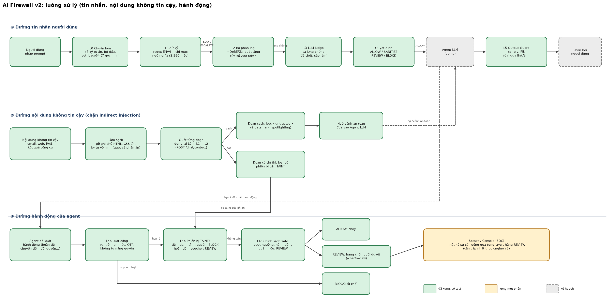

# Sơ đồ luồng xử lý của Firewall

Sơ đồ được vẽ bằng code: `tools/draw_workflow.py` tạo ra `workflow/firewall_workflow.png` (cho slide), `firewall_workflow.svg` (vector) và `firewall_workflow.mmd` (Mermaid, dán vào GitHub/Notion). Khi xong một layer, đổi trạng thái của khối đó trong từ điển `STATUS` ở đầu file rồi chạy lại.

Màu xanh = đã xong và có test, vàng = xong một phần, xám nét đứt = kế hoạch.

## Ba đường đi
1. **Tin nhắn người dùng**: L0 chuẩn hóa → L1 chữ ký → L2 mDeBERTa → (L3 LLM judge cho ca lưng chừng) → quyết định (ALLOW / SANITIZE / REVIEW / BLOCK, mức nặng nhất thắng) → agent LLM → L5 kiểm tra đầu ra → phản hồi.
2. **Nội dung không tin cậy** (email, web, RAG, kết quả công cụ): làm sạch nội dung ẩn → quét từng đoạn bằng L0+L1+L2 → đoạn độc bị loại và phiên bị TAINT; đoạn sạch được bọc và datamark rồi mới vào ngữ cảnh của agent.
3. **Hành động của agent**: L4a luật cứng → L4b phiên có bị TAINT không → L4c ngưỡng và tần suất theo YAML → ALLOW chạy, REVIEW vào hàng chờ người duyệt, hoặc BLOCK.

Nguyên tắc chung: layer nào hỏng hoặc thiếu model thì không bao giờ cho ra ALLOW cuối (fail-closed), và mọi BLOCK/REVIEW được ghi vào nhật ký cho Security Console.

## Mã Mermaid (cùng nội dung, để chỉnh bằng tay nếu cần)
Xem `workflow/firewall_workflow.mmd`.
