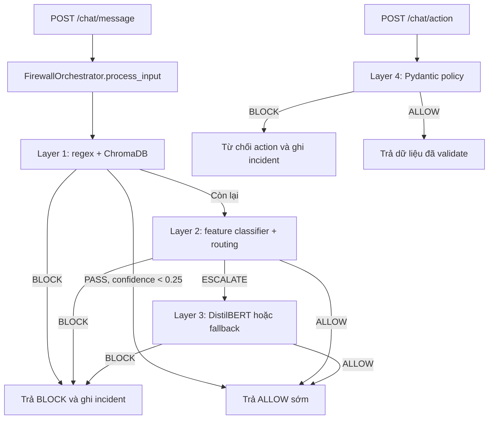

# Hướng dẫn AI phân tích dự án và viết báo cáo

Tài liệu này cung cấp bối cảnh dự án và một prompt mẫu để yêu cầu AI đọc mã nguồn, sau đó hỗ trợ viết báo cáo môn học. Nội dung mô tả kiến trúc theo code hiện có; khi viết báo cáo, cần kiểm tra lại trạng thái file và kết quả chạy thực tế.

## 1. Tóm tắt dự án

**Prompt Injection Firewall** là prototype bảo vệ ứng dụng hội thoại trước prompt injection, jailbreak và các action vượt quyền. Backend dùng FastAPI. Hệ thống có ba layer kiểm tra nội dung prompt theo luồng có điều kiện, cùng một bộ policy riêng để validate action nghiệp vụ. Đây là prototype/demo nghiên cứu, không nên mô tả là giải pháp production đã được chứng minh.

Một phân biệt quan trọng: Layer 4 không chạy nối tiếp sau Layer 3 trong `process_input`. Prompt đi qua Layer 1, Layer 2 và có thể Layer 3; action đi qua Layer 4 theo endpoint riêng.

## 2. Bản đồ mã nguồn

| Đường dẫn | Vai trò |
|---|---|
| `api/main.py` | Khởi tạo FastAPI, đăng ký route, CORS, static UI và health endpoint. |
| `api/routes/chat.py` | Cung cấp `/chat/message` để kiểm tra prompt và `/chat/action` để kiểm tra action. |
| `api/routes/security_console.py` | Cung cấp API xem incidents, thống kê và xóa log demo. |
| `api/schemas.py` | Request/response models bằng Pydantic. |
| `api/incident_store.py` | Giữ incidents trong bộ nhớ và lưu tối đa 200 mục gần nhất vào `data/incidents.json`. |
| `firewall/orchestrator.py` | Điều phối luồng prompt Layer 1 -> Layer 2 -> Layer 3; gọi Layer 4 qua phương thức riêng. |
| `firewall/baseline.py` | Bộ phân loại baseline chỉ dùng regex, phục vụ so sánh đánh giá. |
| `firewall/layer1.py` | Regex và tìm kiếm tương đồng trên ChromaDB. |
| `firewall/layer2.py` | Nạp model phân loại, tính điểm, áp dụng cue gate và định tuyến ngữ nghĩa. |
| `firewall/layer3.py` | Nạp DistilBERT nếu checkpoint tồn tại; nếu không, dùng heuristic fallback. |
| `firewall/layer4.py` | Pydantic schemas và quy tắc nghiệp vụ cho refund/data access. |
| `models/layer1_prefilter/` | Pattern và script tạo vector database. |
| `models/layer2_xgboost/` | Feature extraction, tạo feature dataset và train bộ phân loại Layer 2. |
| `models/layer3_distilbert/` | Script fine-tune DistilBERT và thư mục checkpoint local. |
| `data/scripts/` | Tải/chuẩn hóa dataset và tạo train, validation, test splits. |
| `evaluation/` | Script đánh giá baseline, Layer 1+2 và latency; kết quả JSON ở `evaluation/results/`. |
| `tests/` | Unit/integration-style tests cho API, các layer và orchestrator. |
| `frontend/app-demo/` | Giao diện demo chat. |
| `frontend/security-console/` | Giao diện console theo dõi incidents. |
| `frontend/static/` | Giao diện tĩnh được FastAPI phục vụ nếu thư mục tồn tại. |
| `docs/` | Tài liệu kiến trúc, system card, readiness, rủi ro và kịch bản demo. |

## 3. Luồng xử lý



### Layer 1: Regex và vector prefilter

- Regex chặn các mẫu rõ ràng như yêu cầu bỏ qua chỉ dẫn, jailbreak, lộ system prompt, một số SQL/script patterns.
- Nếu ChromaDB collection `jailbreak_patterns` tồn tại, layer truy vấn một tài liệu gần nhất bằng embedding `all-MiniLM-L6-v2`. Similarity được tính từ `1 - distance`.
- Mặc định: similarity >= 0.85 trả `BLOCK`; từ 0.60 đến dưới 0.85 trả `ESCALATE`; dưới 0.60 trả `PASS`.
- Nếu vector store không khởi tạo được, layer tiếp tục ở chế độ regex-only.
- Orchestrator cho phép sớm khi Layer 1 trả `PASS` và confidence < 0.25.

### Layer 2: Feature classifier và semantic routing

- `models/layer2_xgboost/features.py` trích xuất 25 feature số: độ dài, tỷ lệ chữ/ký tự, cấu trúc, code/URL/SQL, dấu hiệu role claim, urgency, override, prompt leak và các cue khác.
- Nếu `models/layer2_xgboost/model.pkl` được nạp, classifier gọi `predict_proba`; nếu không, code dùng heuristic dựa trên một số feature.
- Ngưỡng mặc định: confidence >= 0.85 là `BLOCK`; dưới 0.50 là `ALLOW`; vùng còn lại là `ESCALATE`.
- Một nhóm regex cue về exploit, malware, ICS/SCADA và chỉ dẫn ẩn trong tài liệu/email có thể ép `ESCALATE`.
- Cue gate hạn chế block chỉ dựa trên đặc trưng hình thức như độ dài hoặc dấu câu.

### Layer 3: DistilBERT

- Được gọi khi Layer 2 trả `ESCALATE`.
- Khi checkpoint đọc được, tokenizer cắt đầu vào tối đa 256 token, model tính softmax cho lớp malicious; ngưỡng mặc định 0.65 để `BLOCK`.
- Khi không nạp được checkpoint, code dùng heuristic từ một danh sách indicator tiếng Anh. Đây không tương đương với việc chạy DistilBERT.
- **Trạng thái phân phối hiện tại:** trọng số `models/layer3_distilbert/checkpoint/model.safetensors` bị ignore và không nằm trong GitHub để repo gọn. Máy phát triển có thể có model local; người clone repo không mặc định có model và sẽ chạy fallback cho Layer 3 cho đến khi tự cung cấp checkpoint.

### Layer 4: Policy cho action

- Được gọi riêng qua `/chat/action`, không phải qua `process_input`.
- Action type không biết sẽ bị block.
- `refund`: yêu cầu các trường bắt buộc; amount và order value phải dương; role phải thuộc `support_agent`, `supervisor`, `admin`, `finance_lead`; refund không vượt 110% order value; support agent không được refund quá 200 USD.
- `data_access`: một số resource như `system_prompt`, `credentials`, `database_dump`, `internal_keys`, `shadow_file` chỉ được phép khi role là `security_admin` theo rule hiện tại.
- Đây là validation deterministic, không phải model học máy.

## 4. API và vận hành

- `GET /health`: trạng thái service và tên các layer.
- `POST /chat/message`: nhận prompt, trả decision, lý do, latency, trace và câu trả lời demo giả lập nếu được allow. Đây chưa phải kết nối đến một LLM production.
- `POST /chat/action`: validate action và trả decision/data đã validate.
- `GET /console/incidents?limit=...`: lấy incidents gần nhất.
- `GET /console/stats`: tổng số incidents, phân bố theo layer và latency trung bình.
- `POST /console/clear`: xóa log phục vụ demo.
- FastAPI docs mặc định ở `/docs`; ứng dụng được chạy local qua `python -m uvicorn api.main:app --reload`.
- Cần đọc `requirements.txt`, Docker files và route code để khẳng định chính xác cách triển khai; không suy ra các tính năng production chỉ từ tên thư mục hoặc mục tiêu trong tài liệu.

## 5. Dữ liệu, huấn luyện và đánh giá

- `data/scripts/prepare_real_datasets.py` chuẩn hóa dữ liệu thành `text`, nhãn, nguồn và loại attack; nguồn Deepset được thử mặc định, BIPIA là tùy chọn, safe CSV có thể truyền vào. Script loại bản ghi trùng và tạo các split có stratification.
- Layer 2 dùng `build_feature_dataset.py` để tạo features rồi `train.py` để chia train/test 80/20 với seed 42, train XGBoost (hoặc GradientBoosting fallback khi không dùng được XGBoost), và xuất metrics.
- Layer 3 dùng `ground_truth_layer3.csv`, chia train/eval 80/20, fine-tune `distilbert-base-uncased` tối đa 3 epochs, sequence length 256, learning rate `2e-5`, chọn checkpoint theo F1.
- Đánh giá baseline và Layer 1+2 nằm trong `evaluation/eval_baseline.py` và `evaluation/eval_layer2.py`. Benchmark latency nằm trong `evaluation/benchmark_latency.py`.
- Các file kết quả hiện có là snapshot theo lần chạy, không tự chứng minh rằng cùng kết quả tái lập được từ trạng thái code/dataset hiện tại. Phải ghi rõ dataset, split, model artifact, lệnh chạy và phạm vi benchmark.

### Cảnh báo về số liệu

Các tài liệu/kết quả hiện có chứa số liệu không nhất quán. Ví dụ, `evaluation/results/layer2_comparison.json` ghi dataset 738 mẫu, recall baseline 36.93%, recall Layer 1+2 là 39.31%, và `layer2_handled_count` bằng 0; nhưng `docs/ai_system_card.md` ghi recall Layer 1+2 là 99.09% cùng ROC-AUC 0.9998. Không được chọn số đẹp hơn hoặc ghép số liệu từ các lần chạy khác nhau. AI cần mở script và kết quả gốc, kiểm tra artifacts/dataset, và báo cáo sự không nhất quán nếu chưa thể tái lập.

Tương tự, latency trong `evaluation/results/latency_benchmark.json` là benchmark local trên tập prompt nhỏ và cấu hình cụ thể của script. Không gọi các số này là latency production hay SLA. Kiểm tra benchmark có đưa Layer 3 thật vào đường đo hay không trước khi mô tả là toàn bộ hệ thống.

## 6. Giới hạn cần phản ánh trong báo cáo

- Đây là prototype nghiên cứu/demo; không tuyên bố đã đạt production readiness.
- Layer 3 có thể chạy fallback nếu không có checkpoint; fallback không có cùng khả năng với DistilBERT.
- Các pattern và semantic routing có phần dựa trên danh sách rule thủ công; có nguy cơ false positive/false negative và phụ thuộc ngôn ngữ.
- Cần phân biệt prompt filtering với authorization: prompt được allow không có nghĩa action được phép.
- Cần kiểm tra nguồn, license, cách gán nhãn, cân bằng lớp, trùng lặp và split dữ liệu trước khi khẳng định chất lượng tổng quát.
- Cần nêu đúng trạng thái của xác thực, phân quyền, rate limit, CORS, xử lý lỗi, privacy/retention và giám sát theo code hiện tại; không mô tả các biện pháp chưa triển khai như đã có.
- Lịch sử `data/incidents.json` có thể chứa prompt nguyên văn; xem xét đây là dữ liệu nhạy cảm khi mô tả quyền riêng tư.

## 7. Prompt mẫu để AI viết báo cáo

Sao chép prompt dưới đây vào AI có quyền đọc workspace/repository. Điền các phần trong ngoặc vuông nếu đã có yêu cầu cụ thể từ giảng viên.

```text
Bạn là trợ lý phân tích phần mềm và viết báo cáo học thuật bằng tiếng Việt.
Hãy đọc repository PromptInjectionFirewall trong workspace hiện tại trước khi
viết. Báo cáo cần mô tả đúng implementation và kết quả có bằng chứng, không
quảng cáo dự án.

THÔNG TIN BÀI BÁO CÁO
- Môn học: [điền tên môn]
- Yêu cầu/đề tài của giảng viên: [dán yêu cầu]
- Độ dài hoặc số trang: [điền nếu có]
- Quy cách trích dẫn: [điền nếu có]
- Thông tin sinh viên/nhóm: [điền hoặc để placeholder]

QUY TẮC PHÂN TÍCH
1. Đọc mã nguồn liên quan trước khi kết luận. Ưu tiên implementation và test
   hiện tại; dùng README/docs làm bối cảnh, không xem mục tiêu thiết kế là
   bằng chứng rằng chức năng đã hoàn tất.
2. Kiểm tra tối thiểu: api/main.py, api/routes/chat.py,
   api/routes/security_console.py, api/schemas.py, api/incident_store.py,
   firewall/orchestrator.py, firewall/baseline.py, firewall/layer1.py,
   firewall/layer2.py, firewall/layer3.py, firewall/layer4.py,
   models/layer2_xgboost/features.py, các script train/data/evaluation liên
   quan và test tương ứng.
3. Mô tả chính xác rằng Layer 1-3 kiểm tra prompt theo routing của
   orchestrator; Layer 4 validate action riêng qua /chat/action, không phải
   một bước tuần tự sau Layer 3.
4. Phân biệt model thật với fallback. Kiểm tra checkpoint Layer 3 có tồn tại
   trong workspace đang phân tích hay không. Repo GitHub hiện không chứa
   model.safetensors; không được nói người clone có sẵn DistilBERT checkpoint.
5. Không bịa metric, số mẫu, test pass, benchmark, dữ liệu, nguồn tham khảo,
   tính năng bảo mật hoặc kết quả triển khai. Mỗi con số phải ghi nguồn file,
   dataset/split và điều kiện đo nếu tìm được. Nếu thiếu bằng chứng, ghi
   "chưa xác minh" hoặc đề xuất lệnh kiểm chứng.
6. Đặc biệt đối chiếu evaluation/results/layer2_comparison.json với
   docs/ai_system_card.md: các số recall/ROC-AUC hiện không nhất quán. Không
   khẳng định Layer 1+2 đạt 99.09% recall nếu chưa tái lập được từ code và
   dữ liệu. Kiểm tra evaluation/benchmark_latency.py trước khi gọi latency là
   end-to-end; đây là benchmark local, không phải SLA production.
7. Khi dẫn chứng implementation, ghi đường dẫn file và tên class/function.
   Không bịa số dòng. Phân biệt rõ: (a) chức năng đã cài đặt, (b) kết quả đã
   đo, (c) mục tiêu/đề xuất tương lai.
8. Nêu rủi ro và giới hạn: prototype/demo; khả năng fallback khi thiếu model;
   độ bao phủ dữ liệu/ngôn ngữ; false positive/false negative; chất lượng
   split/nhãn; CORS/auth/rate limit nếu chưa được triển khai; và việc incident
   có thể lưu prompt nguyên văn.
9. Không tuyên bố firewall tự nó đảm bảo an toàn tuyệt đối. Giải thích prompt
   filtering khác authorization cho action và vì sao vẫn cần kiểm tra action.
10. Nếu có yêu cầu bài tập còn thiếu, dùng placeholder hoặc ghi giả định rõ
    thay vì tự điền tên sinh viên, giảng viên hay trích dẫn học thuật.

HÃY TẠO BÁO CÁO THEO CẤU TRÚC
1. Trang bìa với placeholder cho thông tin chưa biết.
2. Tóm tắt và từ khóa.
3. Bối cảnh, vấn đề, mục tiêu và phạm vi.
4. Yêu cầu chức năng/phi chức năng và giả định.
5. Kiến trúc tổng thể; thêm Mermaid flowchart nếu hữu ích.
6. Thiết kế và cách hoạt động của từng layer, orchestrator, API và incident
   console; chỉ nêu chi tiết được xác minh trong code.
7. Dữ liệu và phương pháp huấn luyện/đánh giá; tách riêng Layer 1, 2, 3,
   baseline và Layer 4 deterministic.
8. Kết quả thực nghiệm: bảng metric có nguồn và điều kiện đo. Nếu số liệu
   mâu thuẫn hoặc chưa tái lập, tạo mục "Vấn đề về tính nhất quán của kết quả"
   thay vì chọn một số liệu.
9. Hướng dẫn chạy/thử nghiệm dựa trên README và scripts; không giả định model
   Layer 3 có trong bản clone.
10. Bảo mật, riêng tư, giới hạn, rủi ro và hướng phát triển.
11. Kết luận.
12. Bảng truy vết tuyên bố: mỗi kết luận kỹ thuật quan trọng -> file/function
    hoặc kết quả thực nghiệm làm bằng chứng.

Văn phong học thuật, tiếng Việt rõ ràng, giải thích thuật ngữ ở lần xuất hiện
đầu tiên. Tránh lặp ý và tránh biến mô tả kiến trúc thành tuyên bố hiệu quả.
Trước khi kết thúc, liệt kê các điểm chưa thể xác minh và các lệnh/test cần
chạy để hoàn thiện báo cáo. Nếu repository có yêu cầu định dạng riêng, ưu tiên
yêu cầu đó.
```

## 8. Cách dùng

1. Mở repository trong AI có quyền đọc file workspace.
2. Dán prompt mẫu và điền yêu cầu môn học/độ dài/định dạng trích dẫn.
3. Yêu cầu AI đưa ra danh sách file đã đọc và bảng truy vết trước khi chốt bản report.
4. Tự chạy lại test/benchmark cần trích dẫn; không dùng kết quả đã lưu nếu chưa xác nhận dữ liệu và model tương ứng.
5. Đọc lại các placeholder, metric và giới hạn trước khi nộp.ă