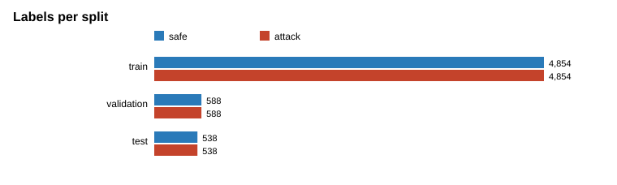
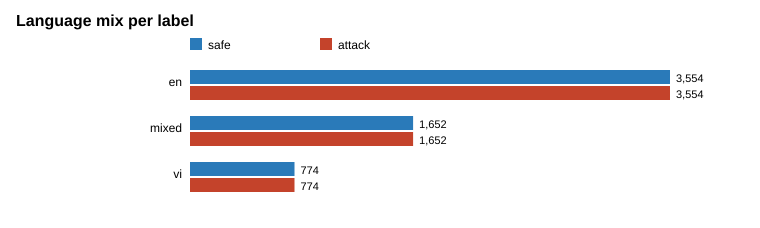
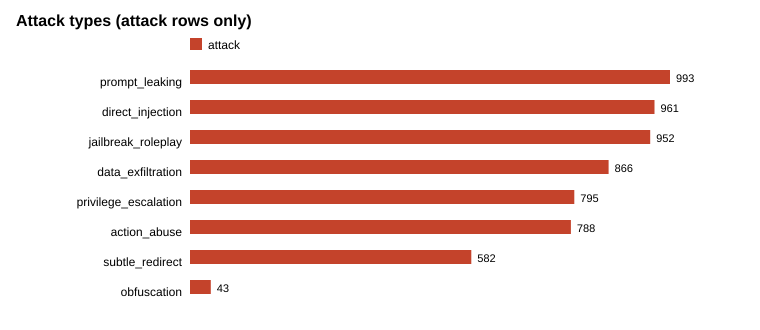
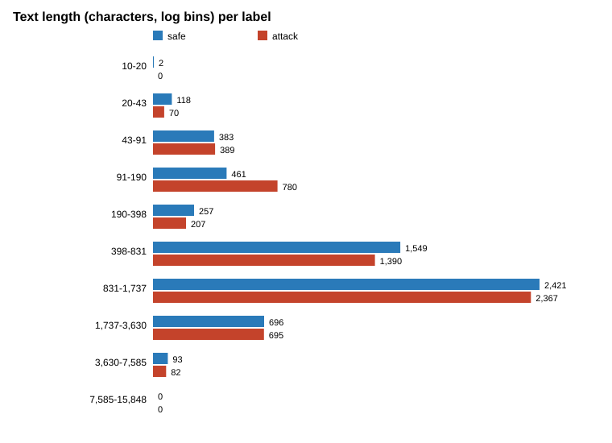

# EDA: dataset v2

- Rows: 11,960 (safe 5,980, attack 5,980)
- Distinct base texts (`orig_id`): 4,545
- Distinct attack templates (`template_id`): 108
- Synthetic rows: 11,960 of 11,960

## Rows by source and label

| source | INJECTION | SAFE |
|---|---|---|
| chat_bank | 174 | 81 |
| doc_base | 4594 | 4896 |
| llm_gen_vi | 291 | 298 |
| tmdeptrai | 921 | 705 |

## Rows by language and label

| lang | INJECTION | SAFE |
|---|---|---|
| en | 3554 | 3554 |
| mixed | 1652 | 1652 |
| vi | 774 | 774 |

## Rows by split and label

| split | INJECTION | SAFE |
|---|---|---|
| test | 538 | 538 |
| train | 4854 | 4854 |
| validation | 588 | 588 |

## Attack types

| attack_type | rows |
|---|---|
| prompt_leaking | 993 |
| direct_injection | 961 |
| jailbreak_roleplay | 952 |
| data_exfiltration | 866 |
| privilege_escalation | 795 |
| action_abuse | 788 |
| subtle_redirect | 582 |
| obfuscation | 43 |

## Variants

| variant | INJECTION | SAFE |
|---|---|---|
| attack_insert_1 | 3497 | 0 |
| attack_insert_2 | 1733 | 0 |
| benign_insert | 0 | 3497 |
| clean | 0 | 2185 |
| pure_attack | 101 | 0 |
| raw | 649 | 298 |

## Text length (characters) by label (0 = safe, 1 = attack)

| label_binary | count | mean | std | min | 25% | 50% | 75% | max |
|---|---|---|---|---|---|---|---|---|
| 0 | 5980.0 | 1011.6 | 800.8 | 17.0 | 497.8 | 874.0 | 1324.0 | 7200.0 |
| 1 | 5980.0 | 977.2 | 796.0 | 21.0 | 427.0 | 862.0 | 1323.0 | 7196.0 |

## Charts

- 
- 
- 
- 
